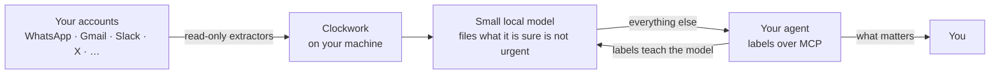

<p align="center">
  
</p>

# Clockwork: stop scrolling, let your agent do it for you

<p>
  
  
  
  
  <a href="LICENSE"></a>
</p>

**Clockwork** reads your feeds in real time, sorts them on your own machine, and alerts your agent when something
important comes in.

Read-only extractors collect your WhatsApp, Gmail, Slack, X and a dozen other sources. A small local model files each
item as `urgent`, `later` or `ignore`. Your agent teaches it over MCP, and decides what to tell you.

**It runs on your machine.** No account, no telemetry, no Clockwork server.

**It only reads.** Nothing can send, reply, react, post or mark as read.

**It alerts your agent.** When something important arrives, Clockwork wakes your agent right away, not at its next
check.

[Website](https://clockworkmcp.com) · [Install](#install) · [Connect your agent](docs/CONNECT.md) · [Sources](#sources) · [How it works](#how-it-works) ·
[Your data](#where-your-data-goes) · [Account risks](docs/RISKS.md) · [Write an extractor](docs/EXTRACTORS.md)

> **Status: early.** Clockwork has run on real accounts and is in a small beta. macOS on Apple Silicon is
> the only tested setup; Linux is untested. Expect rough edges and please [report them](../../issues).

## Why

Most of what is on your screens is not worth your time. Some of it is: the message from the school, the invoice, the
friend who needs an answer today. That is why you keep checking. Until now, the only way to catch the few things that
matter was to look at everything.

An agent can do the looking. For the first time there is a technology that can read all of it for you and pass on only
what you needed. You can spend far less time on screens and still get what they were for.

## Install

Your agent installs Clockwork for you. Say to it:

> Install Clockwork on this machine: clone https://github.com/clockworkmcp/clockwork and follow `agent/INSTALL.md` in it.

It then:

1. **Checks the machine** and installs Clockwork into one folder, with no password and nothing system-wide. If
   something is missing (Node 24+, Python 3.10–3.13 or `uv`) it tells you and asks before installing it.
2. **Connects itself** to Clockwork over MCP and loads its instructions from [agent/SKILL.md](agent/SKILL.md).
3. **Asks which sources you want** and walks you through the parts only you can do: scanning a WhatsApp code, logging
   in to an account, saving a token into a file. It never logs in for you and never sees your passwords.
4. **Arranges to be woken and starts teaching.** It subscribes to Clockwork's alerts, labels what comes in on a
   schedule, and reports back what is running.

The agent is told not to call the install finished until all of that is true: a feed delivering, itself connected,
its wake-ups arranged, labelling under way. `clockwork status` shows the same checklist, so you can see what is
missing. The steps are written down in [agent/INSTALL.md](agent/INSTALL.md) if you want to read them first.

**Want to see it work before linking an account?** After the install, `clockwork demo` runs a throwaway copy with
made-up messages. Connect your agent to it, watch it label, and see it woken when a message from the made-up school
office arrives. Nothing in it is real and it does not touch your real setup.

**If your agent runs in its vendor's cloud** (ChatGPT dots, Grok Bot, Claude Duet), it cannot reach your machine by
itself. Clockwork still runs on your machine; you add a tunnel so the agent can reach it. If the agent can run
commands on your computer it can do the install and walk you through the tunnel; otherwise install by hand. Either
way the steps are in [docs/CONNECT.md](docs/CONNECT.md).

| | |
|---|---|
| Machine | a Mac that stays on |
| Tested on | macOS, Apple Silicon |
| Node | 24+ |
| Python | 3.10–3.13 |
| Disk | about 2 GB |
| Memory | 2 GB free |
| Agent | anything that speaks MCP |
| Account | none |
| Price | free, Apache-2.0 |

WhatsApp needs Go to build its reader once; X needs Google Chrome.

<details>
<summary><b>Install by hand instead</b></summary>

```bash
git clone https://github.com/clockworkmcp/clockwork.git && cd clockwork
./install.sh                  # dependencies, config and the `clockwork` command; no password, nothing system-wide
clockwork doctor              # every line should say ok
clockwork start               # run now and at every login
clockwork connect whatsapp    # link accounts one at a time; `clockwork extractors` lists all seventeen
clockwork agent               # the MCP address, where the agent's token is, and the skill file
clockwork status              # what is running, what setup still needs, and how far each source's model has got
clockwork demo                # optional: a throwaway copy with made-up messages, to try with your agent first
clockwork upgrade             # later: fetch the newest version (shows what is new and asks first)
```

Then connect your agent: [docs/CONNECT.md](docs/CONNECT.md). Full steps: [docs/LOCAL.md](docs/LOCAL.md).

</details>

## The first days

The local model has to earn its job. For each source, it goes through three stages:

1. **Your agent does all the sorting.** It decides `urgent`, `later` or `ignore` for every message, and Clockwork
   keeps each decision as an example.
2. **The model practises.** After about 200 examples it trains overnight, every night. It now guesses on each new
   message, but its guesses change nothing. Clockwork just compares them with what your agent decides.
3. **The model takes the easy ones.** Once at least 30 of the guesses it is sure about have been checked and 95% of
   them match your agent, it starts filing the messages that are clearly not urgent. Your agent keeps everything else.

To see which stage each source is at, ask your agent or run `clockwork status`.

## How it works



- **Extractors** read one account each and hand items to Clockwork. They hold a write-only token: they can add items
  and cannot read yours.
- **The core** stores items in SQLite, runs the decision steps, and serves MCP at `http://127.0.0.1:4600/mcp`.
- **The local model** is a small open embedding model plus a classifier trained on your agent's labels, one per source.
  It files only what it is confident is not urgent.
- **Your agent** labels the rest on a schedule, using what it knows about you, and decides what to tell you.
- **Heads-ups** wake your agent as soon as certain messages arrive, instead of at its next check. The agent writes its
  own rules for this ("anything from the school", "the word *invoice* from this sender"), and the local model adds
  anything else that looks pressing. A heads-up goes to the agent, not to you: it looks, and tells you only if you
  need to know.

More detail: [docs/REFERENCE.md](docs/REFERENCE.md).

## Connect your agent

Any agent that speaks MCP and can run on a schedule will work. It needs three things: the MCP server, the skill in
[agent/SKILL.md](agent/SKILL.md), and a recurring check.

| Agent | Where it runs | How it reaches Clockwork | Tried with Clockwork |
|---|---|---|---|
| [OpenClaw](docs/CONNECT.md#openclaw) | your machine | local address, token | not yet |
| [Hermes Agent](docs/CONNECT.md#hermes-agent) | your machine | local address, token | not yet |
| [ChatGPT dots](docs/CONNECT.md#chatgpt-dots) | OpenAI's cloud | tunnel or remote machine, OAuth | yes |
| [Grok Bot](docs/CONNECT.md#grok-bot) | xAI's cloud | tunnel or remote machine, token | not yet |
| [Claude Duet](docs/CONNECT.md#claude-duet) | Anthropic's cloud | tunnel or remote machine, token | reading works; alerts not solved yet |

An agent on the same machine needs nothing exposed. Most hosted agents run in their vendor's cloud and cannot reach
your machine, so for those you put a tunnel in front of Clockwork: [Tailscale Funnel](https://tailscale.com/kb/1223/funnel)
or any other provider that gives it an https address. Clockwork's own sign-in protects it. The alternative is to run
all of Clockwork on a remote machine, but then your messages live there, and sources that need a browser you log in to
(X) or your own Mac (iMessage) may not work.

Only the ChatGPT dot route has been run end to end. Claude Duet connects and reads, but does not yet subscribe to
Clockwork's events, so it gets no wake-ups. The other three are written from each product's documentation.

Step-by-step instructions for each: [docs/CONNECT.md](docs/CONNECT.md).

## Sources

An extractor is a folder with a manifest and a program that posts items to Clockwork. Seventeen are built in, all off
until you connect them:

| Source | What it brings in | You provide | Setup |
|---|---|---|---|
| WhatsApp | your chats | a scan with your phone | [docs/LOCAL.md](docs/LOCAL.md) |
| Gmail | your inbox | your own Google client | [docs/LOCAL.md](docs/LOCAL.md) |
| Gmail, with an app password | the same mail, with a quicker setup and a broader key | a Google app password | [extractors/gmail-imap](extractors/gmail-imap/README.md) |
| Slack | conversations you are in | your own Slack app | [docs/LOCAL.md](docs/LOCAL.md) |
| X | your home timeline | a login in a separate Chrome window | [docs/LOCAL.md](docs/LOCAL.md) |
| Outlook mail | your Outlook or Microsoft 365 inbox | your own Microsoft app registration | [extractors/outlook](extractors/outlook/README.md) |
| iMessage and SMS | texts on this Mac | Full Disk Access (macOS only) | [extractors/imessage](extractors/imessage/README.md) |
| Calendar | new and changed invitations | your calendar's private feed address | [extractors/calendar](extractors/calendar/README.md) |
| Discord | channels in servers your own bot is in | a bot token | [extractors/discord](extractors/discord/README.md) |
| GitHub | your notifications | a personal access token | [extractors/github](extractors/github/README.md) |
| GitLab | your to-do list | a read-only token | [extractors/gitlab](extractors/gitlab/README.md) |
| Linear | your inbox | a read-only API key | [extractors/linear](extractors/linear/README.md) |
| Jira | issues you are assigned, reported or watch | an Atlassian API token | [extractors/jira](extractors/jira/README.md) |
| Bluesky | replies, mentions and quotes | an app password | [extractors/bluesky](extractors/bluesky/README.md) |
| Mastodon | mentions and other notifications | a read-only token | [extractors/mastodon](extractors/mastodon/README.md) |
| Hacker News | replies to you, and your keywords | your username (no login) | [extractors/hackernews](extractors/hackernews/README.md) |
| RSS / Atom | blogs, status pages, podcasts, YouTube channels, Reddit inbox feeds | feed addresses | [extractors/rss](extractors/rss/README.md) |

WhatsApp, Gmail and X have run on real accounts. **The other fourteen have only been tested against
stand-ins for the real service** (the feed reader and Hacker News also against the live, public services). Expect to
find problems the first time one meets a real account, and please report them.

**Write your own** in a few minutes, or have your agent write one:

```bash
clockwork new my-feed api     # a working extractor from a template: api, mac-app or basic
clockwork check my-feed       # the manifest, one trial run, then offline over sample input, whole and damaged
clockwork enable my-feed
```

`clockwork add <git address>` adds one someone else wrote. It is never installed or updated without you: Clockwork
shows what it will run, records the exact version, and asks first. Added extractors are unreviewed code that runs as
you. The contract and manifest format are in [docs/EXTRACTORS.md](docs/EXTRACTORS.md).

## Where your data goes

- **Stored locally.** Items, labels, the model and the account sessions live in `~/.clockwork/v2` on your machine.
  Nothing is encrypted beyond your disk's own encryption, so turn on FileVault.
- **Read-only.** Nothing in Clockwork sends, replies, reacts, posts or marks anything as read.
- **Your agent reads message content.** To label an item the agent reads it over MCP. If your agent runs on a cloud
  model, that content goes to that model's provider. Clockwork itself has no telemetry and no account, and by default
  contacts no outside service except to download the open embedding model from Hugging Face once at install.
- **Listens on this machine only** unless you set up a public address yourself.

## Documentation

| You want to | Start here |
|---|---|
| Have your agent install it | [agent/INSTALL.md](agent/INSTALL.md) |
| Connect a specific agent | [docs/CONNECT.md](docs/CONNECT.md) |
| Install and link accounts by hand | [docs/LOCAL.md](docs/LOCAL.md) |
| See what your agent is told to do | [agent/SKILL.md](agent/SKILL.md) |
| Write or add an extractor | [docs/EXTRACTORS.md](docs/EXTRACTORS.md) |
| Understand how an item is decided, tokens, alerts and heads-ups | [docs/REFERENCE.md](docs/REFERENCE.md) |
| Know the risks to your accounts before linking them | [docs/RISKS.md](docs/RISKS.md) |
| See what changed between versions | [CHANGELOG.md](CHANGELOG.md) |
| Report a security problem | [SECURITY.md](SECURITY.md) |

## Development

```bash
(cd core && npm ci && node --test)        # core tests
node --test cli/test/cli.test.mjs         # CLI and supervisor tests
node --test extractors/*/*.test.mjs       # extractor tests
```

Use a throwaway data folder for anything you run: `CLOCKWORK_DATA=$(mktemp -d) clockwork init`. Read
[CONTRIBUTING.md](CONTRIBUTING.md) before opening a pull request; coding agents should read [AGENTS.md](AGENTS.md).

## The name

In *A Clockwork Orange*, Alex DeLarge is put through the Ludovico Technique: strapped into a cinema seat, his eyelids
held open with metal clamps, and made to watch film after film while a doctor drips liquid into his eyes. Keeping up
with every chat, inbox and timeline can feel like that.

Clockwork straps your agent into the chair instead. It watches every feed, all day, with its eyes held open. It does
not get tired, anxious or hooked. You get up and leave the room, and it comes to find you when something matters.

## Licence

Apache-2.0, see [LICENSE](LICENSE). Third-party components are listed in [NOTICE](NOTICE).
